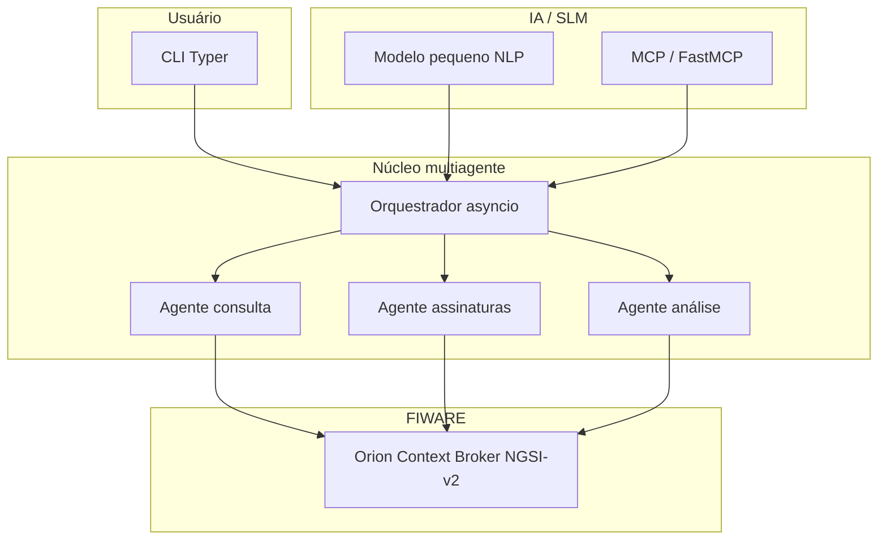
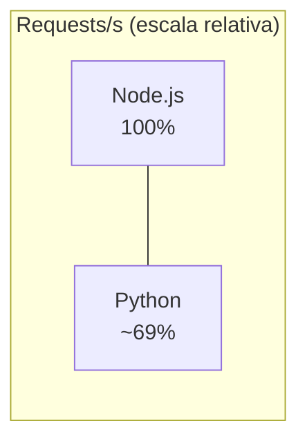
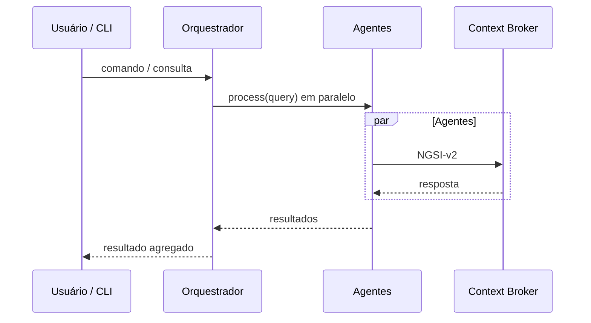
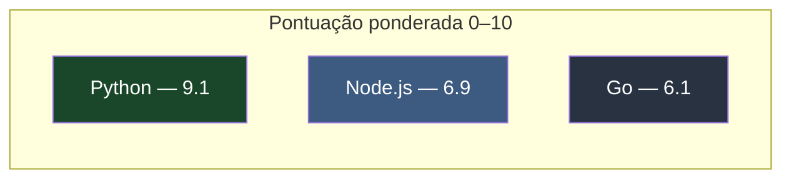

# TCC DKRT — Análise técnica e justificativa Python

**Sistema multiagentes para FIWARE Context Broker com interface CLI e SLM**

Documento de análise técnica que fundamenta a escolha do **Python** como linguagem principal para o desenvolvimento de um sistema multiagentes integrado ao FIWARE Context Broker, com interface de linha de comando (CLI) e suporte a *Small Language Models* (SLMs).

---

## Índice

1. [Resumo executivo](#1-resumo-executivo)
2. [Visão geral do projeto](#2-visão-geral-do-projeto)
3. [Análise comparativa de linguagens](#3-análise-comparativa-de-linguagens)
4. [Ecossistema FIWARE em Python](#4-ecossistema-fiware-em-python)
5. [Ecossistema CLI em Python](#5-ecossistema-cli-em-python)
6. [Ecossistema IA e SLM em Python](#6-ecossistema-ia-e-slm-em-python)
7. [Concorrência para multiagentes](#7-concorrência-para-multiagentes)
8. [Distribuição e deploy](#8-distribuição-e-deploy)
9. [Matriz de decisão final](#9-matriz-de-decisão-final)
10. [Referências](#10-referências)
11. [Anexo A — Exemplo de código](#anexo-a)

---

## 1. Resumo executivo

Este documento apresenta a análise técnica que fundamenta a escolha do Python como linguagem principal para o desenvolvimento de um sistema multiagentes integrado ao FIWARE Context Broker, com interface de linha de comando (CLI) e suporte a SLMs. A decisão baseia-se em evidências empíricas de desempenho, maturidade do ecossistema, produtividade de desenvolvimento e adequação aos requisitos específicos do projeto.

### Visão de alto nível da solução



---

## 2. Visão geral do projeto

### 2.1 Requisitos técnicos

| Requisito      | Descrição                                                                 |
| -------------- | ------------------------------------------------------------------------- |
| Arquitetura    | Sistema multiagentes para consulta e manipulação de dados no Context Broker |
| Interface      | CLI para usuários finais (instalação local e online)                      |
| Integração IA  | Suporte a SLMs para processamento de linguagem natural                    |
| Protocolos     | NGSI-v2 (Orion Context Broker) e MCP (Model Context Protocol)             |

### 2.2 Restrições

- Baixa latência em consultas ao Context Broker
- Capacidade de lidar com múltiplas requisições simultâneas
- Facilidade de instalação e distribuição
- Manutenibilidade do código multiagente

---

## 3. Análise comparativa de linguagens

### 3.1 Visão geral: Python vs Node.js vs Go

Com base em benchmarks e análises da comunidade, a comparação fundamental é a seguinte:

| Critério               | Python                         | Node.js                      | Go                |
| ---------------------- | ------------------------------ | ---------------------------- | ----------------- |
| Modelo de concorrência | Async/await + threads (GIL)    | Event loop (single-thread)   | Goroutines (CSP)  |
| Performance I/O        | Bom (com asyncio)              | Excelente                    | Excelente         |
| Performance CPU        | Bom (com multiprocessing)      | Limitado                     | Excelente         |
| Ecossistema FIWARE     | Maduro                         | Moderado                     | Limitado          |
| Ecossistema IA/ML      | Dominante                      | Limitado                     | Emergente         |
| Curva de aprendizado   | Baixa                          | Média                        | Alta              |
| Produtividade          | Alta                           | Média–alta                   | Média             |

### 3.2 Benchmark de performance

**Teste I/O bound (relevante para API do Context Broker)**

| Métrica           | Node.js (Express) | Python (FastAPI) | Diferença        |
| ----------------- | ----------------- | ---------------- | ---------------- |
| Requests/segundo  | 55.200            | 38.100           | +44,9% (Node.js) |
| Latência (ms)     | 4,5               | 7,8              | +73% (Node.js)   |
| Memória (MB)      | 130               | 190              | +46% (Python)    |
| Startup time (s)  | 0,3               | 0,8              | +167% (Python)   |

*Fonte: benchmark comparativo Node.js vs Python.*

**Teste de framework CLI (startup time)**

| Framework            | Tempo médio | Performance relativa |
| -------------------- | ----------- | -------------------- |
| argparse (Python std) | 12,3 ms    | Baseline             |
| Click (Python)       | 18,9 ms    | −53%                 |
| Typer (Python)       | 22,1 ms    | −80%                 |
| docopt (Python)      | 25,6 ms    | −108%                |

*Fonte: Typer performance benchmark.*

#### Comparativo visual (throughput I/O bound)

Throughput relativo ao cenário Node.js = 100% (dados da tabela acima; Python ≈ 69% de 55.200 req/s):



*Se o diagrama não aparecer no seu visualizador, use a tabela numérica na seção 3.2.*

### 3.3 Análise do GIL e impacto no projeto

O *Global Interpreter Lock* (GIL) do Python é frequentemente citado como limitação, mas o impacto neste projeto é reduzido porque:

1. **Operações I/O-bound** — consultas ao Context Broker são rede; o GIL é liberado durante a espera.
2. **Async/await** — Python 3.11+ com `asyncio` oferece desempenho competitivo em cenários I/O intensivos.
3. **Arquitetura multiagente** — agentes podem rodar em processos separados (`multiprocessing`) para tarefas CPU-bound.

**Conclusão:** para um sistema que predominantemente aguarda respostas de API (I/O-bound), o GIL não representa gargalo significativo.

---

## 4. Ecossistema FIWARE em Python

### 4.1 Bibliotecas oficiais e maduras

O FIWARE mantém suporte robusto para Python, evidenciado pelo catálogo oficial de *Generic Enablers*:

| Componente        | Linguagem | Status   | Finalidade                              |
| ----------------- | --------- | -------- | --------------------------------------- |
| QuantumLeap       | Python    | Oficial  | Time-series database para NGSI          |
| Anubis            | Python    | Oficial  | Policy enforcement para APIs NGSI       |
| PySpark Connector | Python    | Incubado | Processamento de dados em escala        |
| FiLiP             | Python    | Incubado | Processamento de linguagem natural      |

### 4.2 Bibliotecas de terceiros para FIWARE

| Biblioteca    | Funcionalidade                         | Maturidade |
| ------------- | -------------------------------------- | ---------- |
| filip         | Cliente Python completo para NGSI-v2   | Alta       |
| ngsi-client   | Cliente leve para Orion Context Broker | Média      |
| pydantic-ngsi | Modelos NGSI com validação             | Média      |

### 4.3 Evidência de adoção

- **Telefónica I+D:** múltiplos repositórios Python, incluindo `di-py` e `fiware-keystone-*`.
- **Martel GmbH:** QuantumLeap e Anubis em Python.

---

## 5. Ecossistema CLI em Python

### 5.1 Comparativo de frameworks CLI

| Característica     | argparse | click | typer | plumbum |
| ------------------ | -------- | ----- | ----- | ------- |
| Código necessário  | ~85 linhas | ~65 | ~40 | ~55   |
| Tempo desenvolvimento | 30 min | 20 min | 8–10 min | 15 min |
| Type hints         | Manual   | Bom   | Nativo | Regular |
| Autocomplete       | Não      | Sim   | Sim    | Limitado |
| Rich output        | Não      | Sim   | Sim    | Sim     |

*Fonte: comparativo de frameworks CLI 2025.*

### 5.2 Por que Typer neste projeto

Typer é uma opção sólida como framework CLI moderno devido a:

- **Menos boilerplate** — type hints geram parsing automático.
- **Documentação automática** — help gerado a partir de docstrings.
- **Integração Rich** — cores, barras de progresso, tabelas.
- **Async** — compatível com `async def` para operações assíncronas.

```python
# Exemplo: CLI para agente FIWARE com Typer
import typer
from typing import Optional, List
from pathlib import Path

app = typer.Typer(help="FIWARE Multi-Agent System CLI")

@app.command()
def query(
    entity_id: str = typer.Argument(..., help="ID da entidade (ex: Room1)"),
    entity_type: str = typer.Option("Room", help="Tipo da entidade"),
    attributes: List[str] = typer.Option([], help="Atributos específicos"),
    output: Optional[Path] = typer.Option(None, "--output", "-o", help="Arquivo de saída")
):
    """Consulta entidades no Context Broker"""
    # Lógica do agente aqui
    typer.secho(f"Consulta realizada para {entity_id}", fg="green")

if __name__ == "__main__":
    app()
```

---

## 6. Ecossistema IA e SLM em Python

### 6.1 Dominância em machine learning

| Biblioteca              | Caso de uso           | Relevância para o projeto        |
| ----------------------- | --------------------- | -------------------------------- |
| Transformers (HF)       | SLMs e LLMs           | Alta — NLP para consultas        |
| LangChain               | Orquestração de agentes | Alta — framework de agentes   |
| LlamaIndex              | RAG e contexto        | Média — enriquecimento           |
| FastAPI                 | APIs assíncronas      | Alta — servidor MCP / endpoints  |
| Pydantic                | Validação de dados    | Alta — modelos NGSI tipados      |

### 6.2 SLM em Python

Para interpretação de consultas ao Context Broker, SLMs são adequados:

```python
# Exemplo: SLM para interpretação de consultas
from transformers import AutoModelForCausalLM, AutoTokenizer

class QueryInterpreter:
    def __init__(self):
        self.model = AutoModelForCausalLM.from_pretrained("microsoft/phi-2")
        self.tokenizer = AutoTokenizer.from_pretrained("microsoft/phi-2")

    def parse_natural_language(self, query: str) -> dict:
        """Converte linguagem natural para query NGSI"""
        # Implementação com fine-tuning para domínio FIWARE
        pass
```

### 6.3 Integração MCP (Model Context Protocol)

- **MCP SDK oficial:** pacote `mcp` para servidores e clientes.
- **FastMCP:** framework de alto nível para servidores MCP.

---

## 7. Concorrência para multiagentes

### 7.1 Modelos de concorrência comparados

| Aspecto                   | Python (asyncio) | Node.js   | Go      |
| ------------------------- | ---------------- | --------- | ------- |
| Máximo conexões (estimado)| 10K–50K          | 10K–100K  | 1M+     |
| Memória por conexão       | 8–16 KB          | 4–8 KB    | 2–4 KB  |
| Complexidade (debug)      | Alta             | Média     | Baixa   |
| Escalabilidade horizontal | Boa              | Excelente | Excelente |

*Fonte: análise de modelos de concorrência.*

### 7.2 Arquitetura recomendada para multiagentes

```python
# Padrão de design para multiagentes com asyncio
import asyncio
from typing import List, Dict, Any

class FIWAREAgency:
    """Orquestrador de múltiplos agentes"""

    def __init__(self):
        self.agents: List["BaseAgent"] = []
        self.task_queue = asyncio.Queue()

    async def orchestrate(self, query: str) -> Dict[str, Any]:
        """Executa agentes em paralelo para consulta"""
        tasks = [agent.process(query) for agent in self.agents]
        results = await asyncio.gather(*tasks, return_exceptions=True)
        return self._merge_results(results)
```



---

## 8. Distribuição e deploy

### 8.1 Instalação local vs online

| Cenário            | Solução Python                    | Complexidade  |
| ------------------ | --------------------------------- | ------------- |
| Local (pip)        | `pip install meu-agente`          | Baixa         |
| Local (conda)      | `conda install -c conda-forge …`  | Baixa         |
| Local (binary)     | PyInstaller / Nuitka              | Média         |
| Online (API)       | FastAPI + Docker                  | Média         |
| Online (serverless)| AWS Lambda (Python 3.11+)         | Média–alta    |

### 8.2 Empacotamento para usuário final

```bash
# Instalação simples via pip
pip install fiware-multiagent-cli

# Uso imediato
fiware-agent query Room1 --type Room --pretty
```

**Vantagem Python:** o ecossistema PyPI permite distribuição global com um único comando.

---

## 9. Matriz de decisão final

### 9.1 Critérios ponderados

| Critério            | Peso  | Python | Node.js | Go |
| ------------------- | ----- | ------ | ------- | -- |
| Ecossistema FIWARE  | 25%   | 10     | 6       | 4  |
| Ecossistema IA/SLM  | 20%   | 10     | 4       | 5  |
| Produtividade CLI   | 15%   | 9      | 7       | 6  |
| Performance I/O     | 15%   | 7      | 9       | 10 |
| Curva aprendizado   | 10%   | 9      | 7       | 5  |
| Manutenibilidade    | 10%   | 9      | 8       | 8  |
| Distribuição        | 5%    | 8      | 7       | 7  |
| **Pontuação ponderada** | **100%** | **9,1** | **6,9** | **6,1** |

### Pontuação final (visual)



### 9.2 Recomendação final

**Python** é a linguagem recomendada para este projeto com base em:

- Ecossistema FIWARE maduro (bibliotecas oficiais e comunidade).
- Dominância em IA/ML com acesso direto a SLMs e frameworks de agentes.
- Bom suporte CLI com frameworks modernos como Typer.
- Produtividade elevada com menos código em relação a várias alternativas.
- Curva de aprendizado acessível para a equipe.

### 9.3 Mitigações para limitações

| Limitação              | Mitigação                                      |
| ---------------------- | ---------------------------------------------- |
| Startup mais lento     | `typer-slim` sem Rich; lazy loading            |
| GIL em CPU-bound       | Isolar tarefas pesadas em `multiprocessing`    |
| Consumo de memória     | Otimizar estruturas; usar generators           |

---

## 10. Referências

1. FIWARE Catalogue Release 8.6.1 — Official Component List  
2. Typer Performance Benchmark — CLI Framework Comparison  
3. Node.js vs Python: Real Benchmarks and Performance Analysis  
4. Python async I/O Performance Analysis — Python.org Mailing List  
5. Martel GmbH — FIWARE Python Repositories  
6. Python CLI Frameworks Comparison 2025 — Typer vs Click vs argparse  
7. Concurrency Management in Python and Node.js — Edureka  
8. Telefónica I+D — Python FIWARE Components  
9. Click Library Tutorial — CLI Development Best Practices  
10. Go, Python, Node.js Concurrency Models Comparison  

---

## Anexo A

Exemplo de código — CLI multiagente em Python.

```python
#!/usr/bin/env python3
"""
FIWARE Multi-Agent System CLI
Instalação: pip install fiware-multiagent-cli
"""

import typer
import asyncio
from typing import Optional, List
from rich.table import Table
from rich.console import Console

app = typer.Typer(help="FIWARE Multi-Agent System - Interface CLI")
console = Console()

class FIWAREAgency:
    """Orquestrador de agentes para Context Broker"""

    async def query_entity(self, entity_id: str, entity_type: str) -> dict:
        """Consulta entidade no Orion Context Broker"""
        # Implementação com aiohttp
        pass

agency = FIWAREAgency()

@app.command()
def query(
    entity_id: str = typer.Argument(..., help="ID da entidade"),
    entity_type: str = typer.Option("Room", help="Tipo da entidade"),
    pretty: bool = typer.Option(True, help="Exibir formatado"),
):
    """Consulta dados de uma entidade"""
    result = asyncio.run(agency.query_entity(entity_id, entity_type))

    if pretty:
        table = Table(title=f"Dados de {entity_id}")
        table.add_column("Atributo", style="cyan")
        table.add_column("Valor", style="green")
        for k, v in result.items():
            table.add_row(k, str(v))
        console.print(table)
    else:
        console.print(result)

@app.command()
def agents(
    verbose: bool = typer.Option(False, "--verbose", "-v")
):
    """Lista agentes disponíveis"""
    console.print("[bold green]Agentes carregados:[/bold green]")
    console.print("  • QueryAgent - Consulta entidades")
    console.print("  • SubscribeAgent - Gerencia assinaturas")
    console.print("  • AnalyzeAgent - Análise de dados")

if __name__ == "__main__":
    app()
```

---

*Documento preparado em abril de 2026. Versão 1.0 — para aprovação técnica.*
