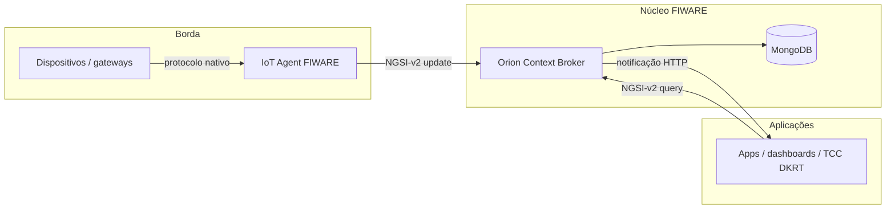

# FIWARE e Orion Context Broker — referência técnica aprofundada

| Campo | Valor |
|-------|-------|
| **Propósito** | Base de conhecimento do TCC DKRT sobre FIWARE, NGSI e Orion |
| **Escopo** | Conceitos verificáveis em documentação oficial, repositórios e literatura |
| **Atualização** | Maio de 2026 |
| **Uso no projeto** | Integração NGSI-v2 com `telefonicaid/fiware-orion` (ver [Fase 4](../../.cursor/specs/fase4.spec.md)) |

Este documento não substitui as especificações normativas. Ele organiza, em profundidade, o que a comunidade FIWARE, a ETSI e os mantenedores do Orion publicam oficialmente — com distinção explícita entre **plataforma (FIWARE)**, **padrão de API (NGSI-v2 / NGSI-LD)**, **papel arquitetural (Context Broker)** e **implementação de referência (Orion)**.

---

## 1. Por que este texto existe

Projetos acadêmicos e industriais frequentemente colapsam quatro ideias distintas em uma só frase (“usamos FIWARE” ≈ “usamos Orion” ≈ “usamos NGSI” ≈ “temos um broker”). Essa compressão gera decisões de arquitetura incorretas — por exemplo, modelar dados em NGSI-LD enquanto o broker exposto é Orion clássico (NGSI-v2), ou tratar `type` em NGSI-v2 como se fosse o `type` semântico de uma classe OWL em JSON-LD.

O objetivo aqui é:

1. Explicar **o que é FIWARE** como ecossistema e conjunto de componentes reutilizáveis.
2. Explicar **o que é o Orion Context Broker** como implementação open source de um Generic Enabler (GE) específico.
3. Descrever o **modelo de informação** e o **contrato de API** com precisão suficiente para implementar clientes (como o `FiwareClient` deste repositório).
4. Registrar **evoluções e limites** (NGSI-v2 fechado, NGSI-LD na ETSI, múltiplos brokers) sem inventar funcionalidades.

Toda afirmação técnica abaixo aponta para fonte primária na seção [12. Referências](#12-referências).

---

## 2. FIWARE: definição, papel e ecossistema

### 2.1 O que é FIWARE (e o que não é)

**FIWARE** é um framework curado de componentes de software open source que podem ser montados — com componentes de terceiros — para acelerar o desenvolvimento de soluções inteligentes (cidades inteligentes, IoT, indústria, mobilidade, espaços de dados, etc.). A definição oficial no catálogo FIWARE descreve-o como um “umbrella” de **Generic Enablers (GEs)**: blocos reutilizáveis com repositório, documentação e imagens de contêiner associadas ([FIWARE/catalogue](https://github.com/FIWARE/catalogue)).

FIWARE **não** é:

- Um único produto monolítico instalável com um único binário.
- Sinônimo de “Orion”: Orion é **um** GE dentro do capítulo *Core Context Management*.
- Um banco de dados: o armazenamento depende da implementação de cada GE (Orion usa MongoDB internamente, mas isso é detalhe de implementação, não definição de FIWARE).
- Um protocolo de sensores: sensores falam MQTT, LoRaWAN, OPC UA, etc.; a tradução para o modelo de contexto costuma passar por **IoT Agents** e APIs NGSI.

FIWARE **é**:

- Um conjunto de **APIs e modelos de dados harmonizados**, centrados na gestão de **informação de contexto** em tempo (quase) real.
- Um ecossistema governado tecnicamente (FIWARE Technical Steering Committee — TSC) com requisitos de contribuição para novos GEs.
- Uma marca de interoperabilidade: plataformas que usam um Context Broker FIWARE para gerir contexto podem ser rotuladas **“Powered by FIWARE”** ([catálogo — Background](https://github.com/FIWARE/catalogue/blob/master/README.md#background)).

### 2.2 Informação de contexto

No vocabulário FIWARE/NGSI, **context information** (informação de contexto) descreve o que está acontecendo no mundo físico ou lógico **agora** — ou em um instante relevante — de forma que aplicações possam consultar, correlacionar e reagir. Exemplos típicos em cidades inteligentes: ocupação de vagas, qualidade do ar, estado de semáforos, localização de frotas.

A especificação NGSI-v2 define explicitamente três faces da API ([FIWARE-NGSI v2 Specification, Introduction](https://github.com/telefonicaid/fiware-orion/blob/master/doc/apiary/v2/fiware-ngsiv2-2.0-2018_09_15.apib)):

| Face | Função |
|------|--------|
| **Modelo de dados** | Entidades, atributos e metadados que representam “coisas” e suas propriedades |
| **Interface de dados de contexto** | Operações de consulta, atualização e assinatura (publish/subscribe) |
| **Interface de disponibilidade de contexto** | Registros que indicam *onde* obter dados (provedores externos, encaminhamento) |

O **Context Broker** materializa essas interfaces num serviço HTTP (REST) central na arquitetura.

### 2.3 Generic Enablers e capítulos arquiteturais

O catálogo organiza GEs em capítulos ([FIWARE/catalogue — Contents](https://github.com/FIWARE/catalogue/blob/master/README.md#contents)):

| Capítulo | Papel |
|----------|-------|
| **Core Context Management** | Broker, conectores de histórico (QuantumLeap, Draco), bibliotecas NGSI |
| **IoT / Robots / Third-party** | IoT Agents, gateways de protocolo |
| **Processing, analysis, visualization** | CEP, dashboards, análise |
| **API management, security, publication** | Monetização, controle de acesso, publicação de datasets |
| **Deployment tools** | Docker, Helm, receitas Kubernetes |

O único componente **obrigatório** para uma solução “Powered by FIWARE” é um **FIWARE Context Broker** que exporte a API NGSI para integração ([catálogo](https://github.com/FIWARE/catalogue/blob/master/README.md#background)). Os demais GEs são opcionais; a plataforma pode misturar software FIWARE e não-FIWARE desde que o broker de contexto seja FIWARE-compatível.

### 2.4 FIWARE Foundation, releases e materiais de aprendizado

A **FIWARE Foundation** coordena a evolução dos padrões e implementações open source referenciadas no catálogo. Releases nomeados (ex.: FIWARE 8.x) agrupam versões compatíveis de GEs; o catálogo aponta para matrizes de conformidade NGSI-LD entre brokers ([NGSI-LD Brokers Implementation Status](https://fiware.github.io/catalogue/excel/NGSI-LD%20Brokers%20Implementation%20Status.xlsx)).

Recursos oficiais de estudo (não normativos, mas alinhados):

- [FIWARE Academy](https://fiware-academy.readthedocs.io/)
- [Tutorials Step-by-Step](https://github.com/FIWARE/tutorials.Step-by-Step)
- [Ask.FIWARE](https://ask.fiware.org) e Stack Overflow com tag `fiware`

### 2.5 Reconhecimento institucional (CEF Building Block)

Em 2018, o **FIWARE Context Broker** (implementação de referência na época: Orion) foi integrado como **Connecting Europe Facility (CEF) Digital Building Block** — bloco reutilizável para administrações públicas e integradores europeus gerenciarem e compartilharem dados contextuais em tempo real via REST ([FIWARE — CEF Building Block](https://www.fiware.org/2018/08/08/fiware-context-broker-launches-as-a-cef-building-block/), [EU Digital Building Blocks — Context Broker](https://ec.europa.eu/digital-building-blocks/sites/display/DIGITAL/Discover+Context+Broker)). Isso reforça o papel do broker como **infraestrutura transversal**, não como detalhe de um único projeto vertical.

### 2.6 Smart Data Models e interoperabilidade semântica

Além da API, a interoperabilidade prática depende de **modelos de dados compartilhados**. O programa [Smart Data Models](https://github.com/smart-data-models/) publica esquemas JSON/JSON-LD alinhados a domínios (energia, mobilidade, turismo, etc.), consumíveis em NGSI-v2 e NGSI-LD. Eles não substituem a especificação NGSI, mas reduzem divergência de nomes de atributos entre cidades e fornecedores.

---

## 3. Linha do tempo NGSI: de OMA a ETSI NGSI-LD

Compreender a evolução evita anacronismos (ex.: documentação NGSI-v1 em projeto novo).

| Fase | Padrão / artefato | Situação |
|------|-------------------|----------|
| Origem | NGSI (Open Mobile Alliance) | Base histórica para gestão de contexto em serviços móveis |
| FIWARE NGSI v2 | [FIWARE-NGSI v2.0 (2018-09-15)](https://fiware.github.io/specifications/ngsiv2/stable/) | Especificação **fechada e estável**; repositório indica que não há “latest”, apenas `stable` |
| API de produto Orion | [FIWARE NGSIv2 Orion API](https://fiware-orion.readthedocs.io/en/stable/orion-api.md) | Documentação de referência da implementação Orion; inclui notas e extensões |
| NGSI-LD | [ETSI GS CIM 009](https://www.etsi.org/deliver/etsi_gs/CIM/001_099/009/01.09.01_60/gs_cim009v010901p.pdf) (ex.: v1.9.1, 2025-07) | Padrão ETSI ISG CIM; modelo de grafo + JSON-LD |
| Site de referência NGSI-LD | [ngsi-ld.org](https://ngsi-ld.org/) | Portal mantido pela comunidade/ETSI com primers e implementações |

A FIWARE Foundation e a comunidade participam da evolução do NGSI-LD, que **derivou** do trabalho NGSI-v2 ([catálogo](https://github.com/FIWARE/catalogue/blob/master/README.md#background)). O site [ngsi-ld.org](https://ngsi-ld.org/) resume: NGSI-LD é modelo de informação e API para publicar, consultar e assinar contexto; padronizado pela ETSI; evoluiu das especificações NGSI da OMA via FIWARE.

**Implicação para o TCC DKRT:** o escopo atual do repositório é **NGSI-v2 contra Orion clássico** (`/v2/...`), não NGSI-LD (`/ngsi-ld/v1/...`). Migração futura exigiria novo modelo de entidades (URNs, `Property`/`Relationship`, `@context`).

---

## 4. NGSI-v2: modelo de informação e contrato de API

A especificação [FIWARE-NGSI v2.0](https://github.com/telefonicaid/fiware-orion/blob/master/doc/apiary/v2/fiware-ngsiv2-2.0-2018_09_15.apib) define o ciclo de vida completo: atualizações, consultas, registros e assinaturas. Abaixo, os conceitos normativos essenciais.

### 4.1 Entidades (`Entity`)

Uma **entidade** representa uma “coisa” física ou lógica: sensor, pessoa, sala, bilhete de manutenção, veículo, etc. Cada entidade possui:

- **`id`**: identificador único no escopo do tenant/serviço (string).
- **`type`**: tipo semântico da coisa (`temperatureSensor`, `Room`, `Car`…).

A especificação estabelece que a entidade é identificada de forma única pela **combinação de `id` e `type`** — não apenas pelo `id` isolado.

Representação JSON normalizada (estrutura mínima):

```json
{
  "id": "Room2",
  "type": "Room",
  "temperature": {
    "value": 23,
    "type": "Number"
  }
}
```

Convenções da API: propriedades em **camelCase**; sufixo `_url` em URIs HATEOAS ([apib — Conventions](https://github.com/telefonicaid/fiware-orion/blob/master/doc/apiary/v2/fiware-ngsiv2-2.0-2018_09_15.apib)).

### 4.2 Atributos (`Attribute`)

**Atributos** são propriedades da entidade (ex.: `current_speed` do carro `car-104`). Cada atributo tem:

| Campo | Significado |
|-------|-------------|
| **name** | Nome da propriedade (chave no JSON da entidade) |
| **type** | Tipo de valor **NGSI** (não confundir com tipo JSON bruto) |
| **value** | Dado propriamente dito (qualquer tipo JSON permitido) |
| **metadata** (opcional) | Metadados sobre o valor (precisão, unidade, timestamp de observação, etc.) |

Exemplo de atributo com metadado:

```json
"temperature": {
  "value": 23,
  "type": "Number",
  "metadata": {
    "timestamp": {
      "type": "DateTime",
      "value": "2026-05-21T12:00:00.000Z"
    }
  }
}
```

### 4.3 Metadados (`Metadata`)

Metadados descrevem propriedades do **valor do atributo** (ou aparecem em outros pontos da API, conforme a operação). Estrutura análoga à de atributos: `name`, `type`, `value`. A especificação **não prevê** metadados aninhados dentro de metadados.

Metadados de sistema (builtin) incluem, entre outros evoluídos ao longo dos release candidates, `dateCreated`, `dateModified`, `dateExpires` ([apib — Changelog](https://github.com/telefonicaid/fiware-orion/blob/master/doc/apiary/v2/fiware-ngsiv2-2.0-2018_09_15.apib)).

### 4.4 Tipos de valor NGSI vs JSON

NGSI-v2 possui **sistema de tipos próprio** para valores (`Number`, `Text`, `Boolean`, `DateTime`, estruturas geoespaciais, etc.). O tipo JSON do campo `value` pode ser número, string ou objeto, mas o campo `type` declara a semântica NGSI — relevante para consultas geográficas, filtros e validação.

### 4.5 Operações principais (mapa conceitual)

| Grupo | Exemplos de endpoints | Finalidade |
|-------|----------------------|------------|
| **Entidades** | `POST/GET/PATCH/DELETE /v2/entities`, `.../attrs` | CRUD e consultas |
| **Consulta batch** | `POST /v2/op/query` | Consultas com expressões, projeção de attrs/metadata |
| **Atualização batch** | `POST /v2/op/update` | Atualizações em lote com `actionType` |
| **Assinaturas** | `/v2/subscriptions` | Notificações quando contexto muda |
| **Registros** | `/v2/registrations` | Provedores de contexto e encaminhamento |
| **Descoberta** | `GET /v2` | Capacidades do broker (URLs de serviços) |

MIME types centrais: `application/json` para payloads; `text/plain` em operações de valor simples; respostas inaceitáveis geram `406 Not Acceptable` ([apib — MIME Types](https://github.com/telefonicaid/fiware-orion/blob/master/doc/apiary/v2/fiware-ngsiv2-2.0-2018_09_15.apib)).

### 4.6 Consultas: Simple Query Language e geoqueries

NGSI-v2 define linguagem de consulta simples (`q`, `mq` para metadados, filtros por sub-chaves) e consultas geográficas sobre atributos geojson-like. Orion documenta comportamentos e limites em [NGSIv2 Implementation Notes](https://fiware-orion.readthedocs.io/en/stable/user/ngsiv2_implementation_notes/index.html) — **notas de implementação**, não parte da spec fechada, mas críticas para quem integra.

### 4.7 Assinaturas (subscriptions)

**Assinatura** é o mecanismo publish/subscribe do broker:

1. Consumidor registra condição (`subject`) — tipos, filtros, atributos de interesse.
2. Quando o contexto muda e a condição é satisfeita, o broker envia **notificação** HTTP (ou MQTT em extensões Orion) ao endpoint do consumidor.
3. Payloads podem incluir metadados builtin (`previousValue`, `actionType`, etc.) conforme versão da spec.

Orion estende o núcleo com: notificações customizadas, throttling, validação de payload, MQTT — ver manual do usuário.

### 4.8 Registros (registrations) e provedores

**Registro** liga o broker a um **context provider** externo. Quando uma consulta ou atualização refere entidades/atributos sob responsabilidade do provedor, o broker pode **encaminhar** (forward) a requisição ao URL do provedor registrado. Isso permite:

- Arquiteturas distribuídas (dados permanecem no domínio de origem).
- Federação parcial entre brokers/provedores.
- Integração gradual sem centralizar todos os sensores no broker.

Sem registro adequado, o broker só conhece entidades que já foram criadas/atualizadas diretamente nele.

### 4.9 Multi-tenancy: `Fiware-Service` e `Fiware-ServicePath`

Orion (e compatíveis) isolam dados lógicos por cabeçalhos HTTP:

- **`Fiware-Service`**: tenant / serviço lógico (namespace de entidades).
- **`Fiware-ServicePath`**: subdivisão hierárquica (path-like) dentro do serviço.

Documentação: [Multi tenancy — Orion API](https://fiware-orion.readthedocs.io/en/stable/orion-api.html#multi-tenancy). Clientes do TCC devem propagar esses cabeçalhos quando o broker não usa apenas o tenant default.

### 4.10 Status da especificação

O repositório [fiware/specifications/ngsiv2](https://fiware.github.io/specifications/ngsiv2/stable/) declara a spec **fechada** (v2.0 final, 15 set 2018). Evoluções de comportamento aparecem nas **Orion API docs** e notas de implementação, não em uma NGSI-v2.1 oficial.

---

## 5. NGSI-LD: contraste necessário (sem misturar com v2)

NGSI-LD ([ETSI GS CIM 009](https://www.etsi.org/deliver/etsi_gs/CIM/001_099/009/01.09.01_60/gs_cim009v010901p.pdf), [portal HTML](https://cim.etsi.org/NGSI-LD/official/front-page.html)) redefine o modelo:

| Aspecto | NGSI-v2 | NGSI-LD |
|---------|---------|---------|
| Formato | JSON “plano” com attrs `{value,type}` | JSON-LD com `@context` |
| Identificador | `id` + `type` string | URN (`urn:ngsi-ld:...`) |
| Propriedades | Atributos + metadata | **Property** e **Relationship** |
| Semântica | Tipo NGSI string | Grafos + RDF, core context ETSI |
| API base | `/v2/...` | `/ngsi-ld/v1/...` |
| Consultas | QL simples + geo | Temporal, espacial, grafo |

Exemplo canônico (site [ngsi-ld.org](https://ngsi-ld.org/)):

```json
{
  "@context": [
    "https://smart-data-models.github.io/dataModel.Person/context.jsonld",
    "https://uri.etsi.org/ngsi-ld/v1/ngsi-ld-core-context-v1.8.jsonld"
  ],
  "id": "urn:ngsi-ld:Person:John_Lennon",
  "type": "Person",
  "name": { "type": "Property", "value": "John Lennon" },
  "spouse": { "type": "Relationship", "object": "urn:ngsi-ld:Person:Cynthia_Lennon" }
}
```

**Brokers NGSI-LD** no catálogo FIWARE: Orion-LD, Scorpio, Stellio ([catálogo — Core Context Broker](https://github.com/FIWARE/catalogue/blob/master/README.md#core-context-broker-components)). O Orion **clássico** (`telefonicaid/fiware-orion`) implementa **NGSI-v2** como API principal; para NGSI-LD nativo, a documentação do Orion-LD recomenda usar o projeto [FIWARE/context.Orion-LD](https://github.com/FIWARE/context.Orion-LD) — que também pode expor NGSI-v2 em paralelo, conforme versão.

---

## 6. Orion Context Broker (`telefonicaid/fiware-orion`)

### 6.1 O que é Orion

O **Orion Context Broker** é uma implementação em **C++** do binding REST **NGSIv2**, desenvolvida no âmbito da plataforma FIWARE ([README Orion](https://github.com/telefonicaid/fiware-orion/blob/master/README.md)). No catálogo, aparece como GE **Publish/Subscribe Context Broker** do capítulo Core Context Management.

Funções expostas pela interface NGSI ([README](https://github.com/telefonicaid/fiware-orion/blob/master/README.md)):

1. **Consultar** informação de contexto persistida no broker.
2. **Atualizar** informação de contexto (ingestão de mudanças de estado).
3. **Receber notificações** quando o contexto muda (via subscriptions).
4. **Registrar** aplicações provedoras de contexto (registrations).

Orion **não** é um servidor de páginas, IDE ou painel operacional: é um serviço HTTP programático, tipicamente na porta **1026** em instalações de laboratório.

### 6.2 Relação FIWARE ↔ Orion ↔ Context Broker

| Termo | Natureza |
|-------|----------|
| **FIWARE Context Broker** | Papel arquitetural / GE obrigatório em solução “Powered by FIWARE” |
| **Orion Context Broker** | Implementação open source concreta desse papel para NGSI-v2 |
| **NGSI-v2** | Contrato que Orion implementa (com notas documentadas) |

Na prática, muita documentação FIWARE usa “Context Broker” e “Orion” como sinônimos **porque** Orion foi a implementação de referência histórica e CEF — mas tecnicamente existem outros brokers (Orion-LD, Scorpio, Stellio para LD).

### 6.3 Implementação e persistência

- Código: [github.com/telefonicaid/fiware-orion](https://github.com/telefonicaid/fiware-orion)
- Documentação: [fiware-orion.readthedocs.io](https://fiware-orion.readthedocs.io/en/stable/)
- Licença: **AGPL-3.0** (Telefónica I+D e contribuidores)
- Imagens: Docker Hub `telefonicaiot/fiware-orion`, Quay `fiware/orion`
- Persistência: **MongoDB** (detalhe de deployment; não faz parte da spec NGSI)

### 6.4 Documentação operacional em camadas

| Camada | Conteúdo |
|--------|----------|
| [Quick Start](https://github.com/telefonicaid/fiware-orion/blob/master/doc/manuals/quick_start_guide.md) | Primeiros `curl` contra entidades |
| [Orion API Reference](https://github.com/telefonicaid/fiware-orion/blob/master/doc/manuals/orion-api.md) | Especificação de produto alinhada a NGSI-v2 |
| [User Manual](https://fiware-orion.readthedocs.io/en/stable/user/index.html) | Federação, caching, notificações avançadas |
| [Admin Guide](https://fiware-orion.readthedocs.io/en/stable/admin/index.html) | Instalação, HA, Docker Swarm, tuning |

### 6.5 Fluxo típico de dados (IoT → Orion → aplicação)



1. Dispositivo publica leitura em protocolo industrial/IoT.
2. **IoT Agent** traduz para atualização NGSI-v2 (`POST` entidade ou `PATCH` attrs).
3. Orion persiste e notifica assinantes.
4. Aplicações consultam (`GET /v2/entities`) ou reagem a webhooks de subscription.

Componentes como **Cygnus**, **Draco** ou **QuantumLeap** entram quando há necessidade de **histórico**, streams ou analytics — fora do núcleo CRUD do Orion, mas comuns em arquiteturas FIWARE completas.

### 6.6 Federação e escalabilidad

Orion suporta cenários de **federação** entre brokers (push via subscriptions, pull via registrations/forwarding). Detalhes: manuais de usuário e documentação Orion-LD para cenários NGSI-LD. Para o TCC, federação é cenário avançado; o cliente HTTP deve, no mínimo, respeitar tenancy e timeouts em consultas.

### 6.7 Orion-LD (repositório separado)

[FIWARE/context.Orion-LD](https://github.com/FIWARE/context.Orion-LD) implementa o GE com API **NGSI-LD** (ETSI). O README orienta: se o objetivo é **apenas NGSI-v2**, usar Orion clássico; para testar NGSI-LD, usar imagem `fiware/orion-ld` ([README Orion-LD](https://github.com/FIWARE/context.Orion-LD/blob/master/README.md)). Há menção histórica de convergência de linhas de código — verificar estado atual no repositório antes de assumir um único binário.

### 6.8 Conformidade e testes

Orion participa de testes de conformidade e suites funcionais no próprio repositório (workflows CI, testes E2E). A spec NGSI-v2 descreve nível “full”; implementações podem documentar desvios nas **Implementation Notes**.

---

## 7. Arquitetura de referência em cidades inteligentes

FIWARE promove uma camada de **Context Information Management** que quebra silos verticais (mobilidade, energia, ambiente) ao expor dados sob API comum ([FIWARE Smart Cities](https://www.fiware.org/about-us/smart-cities/)). Pesquisadores descrevem brokers de contexto publish/subscribe de baixa latência no edge/fog para requisitos de cidade ([Rampérez et al., 2018 — fog + context broker](https://doi.org/10.1155/2018/9741986)).

Artigo de visão geral da plataforma ([Cirillo et al., IEEE IoT Magazine, 2019](https://doi.org/10.1109/IOTM.0001.1800022)) discute transição de pesquisa para comercialização e casos em mercado IoT global, analytics urbano e condução autônoma — útil para contextualizar **por que** FIWARE aparece em TCCs de Engenharia de Software e IoT, sem substituir leitura da spec.

---

## 8. (Removido) Implicações para o projeto

Esta seção descrevia a arquitetura multiagente descartada e foi movida para [`docs/legacy/base-secao8-implicacoes-dkrt.md`](legacy/base-secao8-implicacoes-dkrt.md). Ver `.cursor/specs/` para o desenho atual do projeto.

---

## 9. Equívocos frequentes (anti-padrões documentados)

| Equívoco | Correção |
|----------|----------|
| “FIWARE = Orion” | FIWARE é ecossistema; Orion é um GE NGSI-v2 |
| “Orion implementa NGSI-LD nativamente” | Orion clássico: NGSI-v2; NGSI-LD: Orion-LD / Scorpio / Stellio |
| “NGSI-v2 e NGSI-LD são compatíveis por JSON igual” | Modelos diferentes; conversão exige mapeamento explícito |
| “Context Broker armazena séries temporais completas” | Histórico costuma usar QuantumLeap/Draco; Orion foca contexto atual + notificações |
| “Subscription e Registration são a mesma coisa” | Subscription = notificar mudanças; Registration = onde buscar/atualizar dados externos |
| “Existe NGSI-v3 oficial FIWARE” | Não usar este termo; evolução pública é NGSI-LD na ETSI |
| “Metadados podem aninhar metadados infinitamente” | NGSI-v2: não previsto |
| “Qualquer servidor REST é um Context Broker” | Precisa implementar contrato NGSI e papel de broker |

---

## 10. Glossário compacto

| Termo | Definição |
|-------|-----------|
| **GE (Generic Enabler)** | Componente FIWARE catalogado, open source, com critérios de contribuição |
| **Context information** | Representação do que ocorre no mundo real/lógico relevante para apps |
| **Entity** | Coisa com `id` e `type` |
| **Attribute** | Propriedade `{value, type, metadata?}` |
| **Metadata** | Descritor de um valor (ex.: timestamp da medição) |
| **Subscription** | Contrato de notificação por mudança de contexto |
| **Registration** | Contrato de provedor/encaminhamento de contexto |
| **IoT Agent** | Ponte protocolo ↔ NGSI |
| **NGSI-LD Property / Relationship** | Construtos NGSI-LD (não NGSI-v2) |

---

## 11. Checklist de leitura para implementadores

1. [FIWARE-NGSI v2.0 apib](https://github.com/telefonicaid/fiware-orion/blob/master/doc/apiary/v2/fiware-ngsiv2-2.0-2018_09_15.apib) — Terminology + Entity/Attribute
2. [Orion API Reference](https://fiware-orion.readthedocs.io/en/stable/orion-api.md) — endpoints usados no TCC
3. [Orion Quick Start](https://github.com/telefonicaid/fiware-orion/blob/master/doc/manuals/quick_start_guide.md) — lab local
4. [FIWARE/catalogue — Core](https://github.com/FIWARE/catalogue/blob/master/core/README.md) — visão de GEs adjacentes
5. (Futuro LD) [ETSI GS CIM 009](https://www.etsi.org/deliver/etsi_gs/CIM/001_099/009/01.09.01_60/gs_cim009v010901p.pdf) + [NGSI-LD Primer GR CIM 008](https://www.etsi.org/deliver/etsi_gr/CIM/001_099/008/01.02.01_60/gr_CIM008v010201p.pdf)

---

## 12. Referências

### 12.1 Normativas e especificações

- FIWARE-NGSI v2.0 (estável, 2018-09-15): https://fiware.github.io/specifications/ngsiv2/stable/
- Fonte Apib no repositório Orion: https://github.com/telefonicaid/fiware-orion/blob/master/doc/apiary/v2/fiware-ngsiv2-2.0-2018_09_15.apib
- FIWARE NGSIv2 Orion API: https://fiware-orion.readthedocs.io/en/stable/orion-api.md
- ETSI GS CIM 009 NGSI-LD API (ex. v1.9.1): https://www.etsi.org/deliver/etsi_gs/CIM/001_099/009/01.09.01_60/gs_cim009v010901p.pdf
- ETSI GS CIM 006 NGSI-LD Information Model: https://www.etsi.org/deliver/etsi_gs/CIM/001_099/006/01.03.01_60/gs_cim006v010301p.pdf
- Portal NGSI-LD: https://ngsi-ld.org/

### 12.2 FIWARE e Orion (implementação)

- Catálogo FIWARE: https://github.com/FIWARE/catalogue
- Orion Context Broker (README): https://github.com/telefonicaid/fiware-orion
- Documentação Orion RTD: https://fiware-orion.readthedocs.io/en/stable/
- Orion-LD: https://github.com/FIWARE/context.Orion-LD
- Smart Data Models: https://github.com/smart-data-models/
- FIWARE Academy: https://fiware-academy.readthedocs.io/

### 12.3 Institucional

- FIWARE Context Broker como CEF Building Block (2018): https://www.fiware.org/2018/08/08/fiware-context-broker-launches-as-a-cef-building-block/
- EU Digital Building Blocks — Context Broker: https://ec.europa.eu/digital-building-blocks/sites/display/DIGITAL/Discover+Context+Broker

### 12.4 Literatura acadêmica (complementar)

- Cirillo, F. et al. “A Standard-based Open Source IoT Platform: FIWARE.” *IEEE Internet of Things Magazine*, 2019. DOI: [10.1109/IOTM.0001.1800022](https://doi.org/10.1109/IOTM.0001.1800022)
- Rampérez, V.; Soriano, J.; Lizcano, D. “A Multidomain Standards-Based Fog Computing Architecture for Smart Cities.” *Wireless Communications and Mobile Computing*, 2018. DOI: [10.1155/2018/9741986](https://doi.org/10.1155/2018/9741986)
- MDPI Sensors — “Reshaping Smart Cities through NGSI-LD Enrichment” (2024): https://www.mdpi.com/1424-8220/24/6/1858

### 12.5 Documentação interna do repositório

- [Fase 4 — Nível 1 ponta a ponta (spec vigente)](../../.cursor/specs/fase4.spec.md)
- [Pre-projeto TCC](../legacy/entrega/pre_projeto_tcc.md)

---

*Documento elaborado para a base de conhecimento do TCC. Em caso de divergência entre este texto e a especificação normativa vigente no broker implantado, prevalecem a spec ETSI/FIWARE e a documentação da versão exata do Orion/Orion-LD em produção.*
