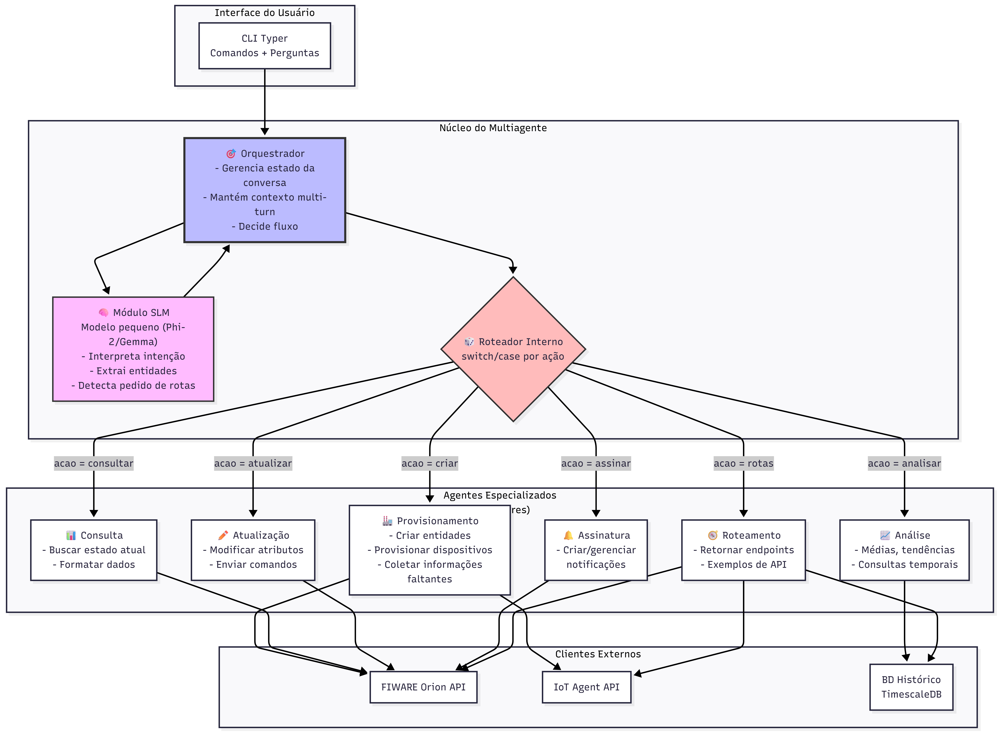
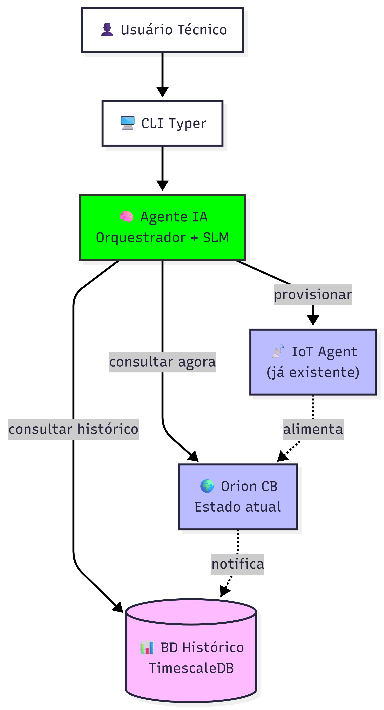
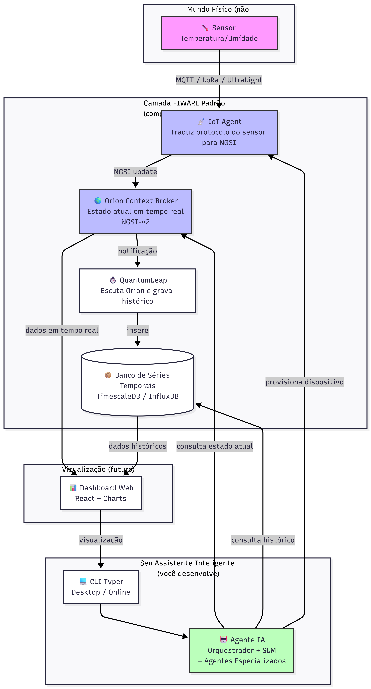
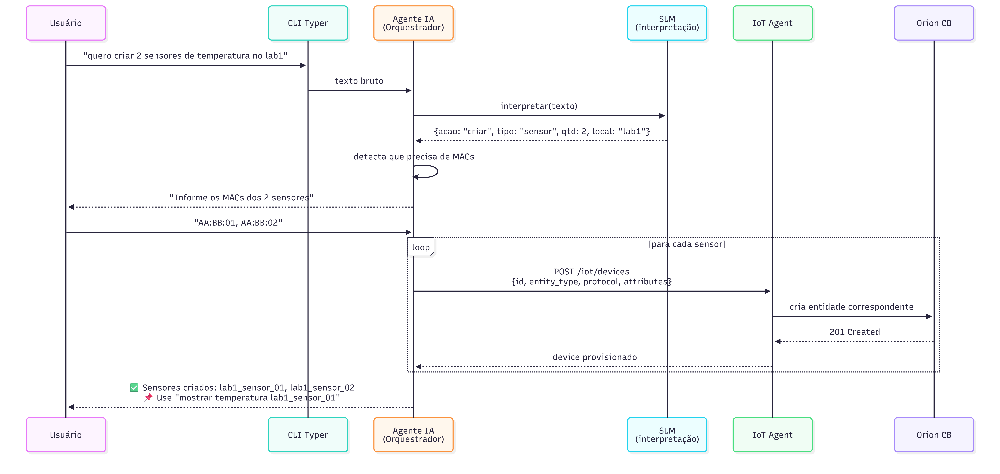

# Pre-projeto de TCC

## Sistema multiagentes para orquestracao do Orion Context Broker

Grupo: DKRT  
Curso: Engenharia de Software / TCC  
Professora: Leide  
Data: maio de 2026  
Repositorio: <https://github.com/TCC-CEFSA-DKRT/TCC_DKRT>

---

## 1. Descricao do projeto

O projeto consiste no desenvolvimento de um sistema multiagentes para auxiliar a consulta, manipulacao e orquestracao de dados no FIWARE Orion Context Broker. A proposta e criar uma camada inteligente entre o usuario e o Context Broker, permitindo que comandos em linguagem natural ou comandos estruturados sejam interpretados por agentes especializados.

A solucao prevista combina uma interface inicial via CLI, uma camada de orquestracao multiagentes e integracao com o Orion Context Broker por meio do protocolo NGSI-v2. Em etapas posteriores, o projeto podera incorporar SLMs, APIs e recursos de MCP para ampliar a capacidade de interpretacao, automacao e integracao com ferramentas externas.

O objetivo principal e simplificar o uso do Orion Context Broker para usuarios que precisam consultar entidades, atributos e contexto de aplicacoes inteligentes, reduzindo a necessidade de conhecer todos os detalhes tecnicos da API NGSI-v2.

## 2. Problema

O Orion Context Broker e uma tecnologia robusta para gerenciamento de contexto, mas seu uso direto exige conhecimento tecnico sobre entidades, tipos, atributos, endpoints e chamadas HTTP. Esse fator aumenta a curva de aprendizado e dificulta a utilizacao por usuarios iniciantes, equipes academicas ou equipes de projeto que precisam validar rapidamente dados de contexto.

Assim, o problema central do projeto e: como facilitar a interacao com o Orion Context Broker por meio de uma solucao organizada, extensivel e capaz de interpretar solicitacoes do usuario, distribuir tarefas entre agentes e retornar respostas compreensiveis?

## 3. Publico-alvo

O publico-alvo inicial e composto por estudantes, pesquisadores, desenvolvedores e equipes tecnicas que utilizam FIWARE em projetos academicos, provas de conceito ou solucoes de cidades inteligentes, IoT e sistemas contextuais.

Tambem sao considerados usuarios potenciais os profissionais que precisam consultar informacoes no Context Broker, mas que nao dominam completamente os detalhes de integracao com NGSI-v2.

## 4. Objetivos

O objetivo geral e desenvolver um sistema multiagentes para orquestrar consultas e operacoes relacionadas ao Orion Context Broker.

Objetivos especificos:

- Criar uma estrutura inicial de projeto em Python.
- Implementar uma primeira funcionalidade de orquestracao multiagentes.
- Definir agentes especializados para interpretacao de intencao e planejamento de consulta.
- Documentar requisitos funcionais e nao funcionais.
- Elaborar backlog inicial e cronograma de desenvolvimento.
- Justificar as tecnologias escolhidas.
- Apresentar prototipos simples do fluxo de uso.
- Manter o desenvolvimento versionado em repositorio Git.

## 5. Requisitos funcionais

- RF-01: O sistema deve receber uma solicitacao do usuario pela interface CLI.
- RF-02: O sistema deve encaminhar a solicitacao para um orquestrador multiagentes.
- RF-03: O sistema deve possuir um agente para identificar intencoes de consulta relacionadas ao Context Broker.
- RF-04: O sistema deve possuir um agente para gerar um plano inicial de consulta NGSI-v2.
- RF-05: O sistema deve retornar uma resposta estruturada ao usuario.
- RF-06: O sistema deve permitir evolucao futura para integracao direta com o Orion Context Broker.
- RF-07: O sistema deve permitir inclusao futura de novos agentes especializados.
- RF-08: O sistema deve manter documentacao tecnica do funcionamento e das decisoes de arquitetura.

## 6. Requisitos nao funcionais

- RNF-01: O sistema deve ser desenvolvido em Python 3.11 ou superior.
- RNF-02: O codigo deve ser modular, favorecendo manutencao e expansao dos agentes.
- RNF-03: A solucao deve utilizar versionamento Git.
- RNF-04: A interface inicial deve ser simples de executar em ambiente local.
- RNF-05: A arquitetura deve permitir evolucao para chamadas assincronas e integracao com APIs.
- RNF-06: O projeto deve priorizar legibilidade e organizacao do codigo.
- RNF-07: A documentacao deve registrar as principais decisoes tecnicas.
- RNF-08: O sistema deve considerar boas praticas de Engenharia de Software, como separacao de responsabilidades, backlog, cronograma e testes.

## 7. Backlog inicial do projeto

| ID | Item | Tipo | Prioridade | Status |
| --- | --- | --- | --- | --- |
| B01 | Criar repositorio Git e estrutura inicial de documentacao | Documentacao | Alta | Concluido |
| B02 | Elaborar justificativa da linguagem Python | Documentacao | Alta | Concluido |
| B03 | Criar diagramas de arquitetura e fluxo | Documentacao | Alta | Concluido |
| B04 | Definir requisitos funcionais e nao funcionais | Documentacao | Alta | Concluido |
| B05 | Criar estrutura inicial do projeto Python | Desenvolvimento | Alta | Concluido |
| B06 | Implementar orquestrador multiagentes inicial | Desenvolvimento | Alta | Concluido |
| B07 | Implementar agente de classificacao de intencao | Desenvolvimento | Alta | Concluido |
| B08 | Implementar agente de planejamento de consulta | Desenvolvimento | Alta | Concluido |
| B09 | Criar CLI simples para entrada do usuario | Desenvolvimento | Alta | Concluido |
| B10 | Adicionar teste unitario inicial | Qualidade | Media | Concluido |
| B11 | Integrar com Orion Context Broker real | Desenvolvimento | Alta | Pendente |
| B12 | Implementar configuracao de endpoint do broker | Desenvolvimento | Alta | Pendente |
| B13 | Evoluir CLI com Typer e exibicao formatada | Desenvolvimento | Media | Pendente |
| B14 | Criar API simples com FastAPI | Desenvolvimento | Media | Pendente |
| B15 | Avaliar integracao com SLM para interpretacao de linguagem natural | Pesquisa | Media | Pendente |
| B16 | Preparar apresentacao e versao final da documentacao | Documentacao | Alta | Pendente |

## 8. Cronograma simplificado

| Periodo | Atividade | Entrega esperada |
| --- | --- | --- |
| Semana 1 | Definicao do tema, problema e publico-alvo | Escopo inicial definido |
| Semana 2 | Levantamento das tecnologias e estudo do FIWARE | Justificativa tecnica |
| Semana 3 | Criacao de diagramas e fluxo da solucao | Diagramas em `docs/` |
| Semana 4 | Elaboracao dos requisitos e backlog | Documento de pre-projeto |
| Semana 5 | Criacao da estrutura inicial do codigo | Pacote Python inicial |
| Semana 6 | Implementacao do orquestrador e agentes iniciais | Funcionalidade basica via CLI |
| Semana 7 | Integracao inicial com Orion Context Broker | Consulta real a entidades |
| Semana 8 | Ajustes de arquitetura e testes | Testes e melhoria do codigo |
| Semana 9 | Prototipo evoluido e refinamento da CLI/API | Fluxo demonstravel |
| Semana 10 | Consolidacao da documentacao e apresentacao | Entrega final do semestre |

## 9. Prototipos e fluxo basico

### 9.1 Fluxo geral da solucao

O fluxo basico previsto e:

1. Usuario informa uma solicitacao pela CLI.
2. O orquestrador recebe a solicitacao.
3. O agente de intencao classifica o pedido.
4. O agente de planejamento define os passos para consulta NGSI-v2.
5. Futuramente, o agente de integracao acionara o Orion Context Broker.
6. O sistema retorna uma resposta estruturada ao usuario.

### 9.2 Protótipo textual da CLI

Tela 1 - Entrada da solicitacao:

```text
$ context-broker-agent "consultar sensores no Context Broker"
```

Tela 2 - Retorno inicial dos agentes:

```json
{
  "request": "consultar sensores no Context Broker",
  "status": "ok",
  "results": [
    {
      "agent": "QueryIntentAgent",
      "status": "ok",
      "message": "Solicitacao classificada como consulta NGSI-v2."
    },
    {
      "agent": "BrokerPlanningAgent",
      "status": "ok",
      "message": "Plano inicial: validar entrada, montar consulta NGSI-v2, acionar Orion Context Broker e formatar resposta ao usuario."
    }
  ]
}
```

### 9.3 Diagramas existentes

Os diagramas abaixo fazem parte da documentacao do projeto e representam a arquitetura e o fluxo pretendidos:









## 10. Tecnologias escolhidas

### Linguagem de programacao: Python

Python foi escolhido por oferecer alta produtividade, boa legibilidade, ampla comunidade e forte ecossistema para IA, automacao, APIs e integracoes. A documentacao existente no `README.md` apresenta uma analise comparativa entre Python, Node.js e Go, indicando Python como melhor opcao para o contexto do projeto por causa da combinacao entre FIWARE, SLMs, CLI e desenvolvimento rapido.

### Interface CLI

A primeira interface do sistema sera uma CLI. Nesta etapa inicial foi utilizada a biblioteca padrao `argparse`, pois ela permite demonstrar rapidamente o fluxo basico sem dependencias externas. Em etapas futuras, a CLI podera evoluir para Typer, que oferece melhor experiencia de uso, tipagem, ajuda automatica e integracao com Rich.

### Backend e API

Para evolucao do projeto, a tecnologia prevista para API e FastAPI, por ser uma opcao moderna em Python, com suporte a documentacao automatica, validacao com Pydantic e bom desempenho em operacoes I/O-bound, que sao comuns em chamadas ao Orion Context Broker.

### Banco de dados

Na fase inicial, o sistema nao exige banco de dados proprio, pois o Orion Context Broker atua como fonte principal de dados contextuais. Em evolucoes futuras, podera ser utilizado PostgreSQL para historico, configuracoes, auditoria e persistencia auxiliar.

### Orion Context Broker e FIWARE

O Orion Context Broker e o componente central de contexto do projeto. Ele sera acessado por meio de endpoints NGSI-v2, permitindo consultar entidades, atributos e metadados.

### IA e SLMs

O uso de SLMs e previsto para interpretar linguagem natural e converter solicitacoes do usuario em planos ou consultas direcionadas ao Context Broker. Essa etapa sera avaliada apos a consolidacao do fluxo basico de agentes.

## 11. Estrutura inicial do projeto

Estrutura criada para demonstrar o inicio pratico do desenvolvimento:

```text
agent_multi_IA_context_broker/
  docs/
    entrega/
      pre_projeto_tcc.md
    cronograma/
    *.png
    *.svg
  src/
    context_broker_agent/
      __init__.py
      agents.py
      cli.py
  tests/
    test_orchestrator.py
  pyproject.toml
  README.md
```

## 12. Funcionalidade basica implementada

Foi implementada uma primeira funcionalidade de orquestracao multiagentes. A CLI recebe uma solicitacao textual, envia para o orquestrador e retorna um JSON com os resultados dos agentes.

Componentes implementados:

- `MultiAgentOrchestrator`: coordena os agentes registrados.
- `QueryIntentAgent`: identifica solicitacoes relacionadas a consultas ao Context Broker.
- `BrokerPlanningAgent`: gera um plano inicial para uma consulta NGSI-v2.
- `cli.py`: disponibiliza a execucao inicial por linha de comando.
- `test_orchestrator.py`: registra um teste unitario da classificacao de consulta.

Exemplo de uso previsto:

```bash
python -m context_broker_agent.cli "consultar sensores no Context Broker"
```

## 13. Evidencias de commits individuais

Historico recente do repositorio:

| Commit | Autor | Data | Descricao |
| --- | --- | --- | --- |
| e9f9fc4 | diego-mobilemed-dev | 2026-04-11 | insercao do cronograma e perguntas alinhamento |
| 3b598b3 | diego-mobilemed-dev | 2026-04-05 | insercao de referencias |
| 888ae65 | diego-mobilemed-dev | 2026-04-05 | insercao dos diagramas |
| 8c65bc8 | diego-mobilemed-dev | 2026-04-05 | correcao da imagem do fluxo |
| 0987d4f | diego-mobilemed-dev | 2026-04-05 | correcao no link |
| de08aec | diego-mobilemed-dev | 2026-04-05 | inclusao das referencias |
| ee3b786 | diego-mobilemed-dev | 2026-04-05 | mudanca dos diagramas para estrutura mais consistente |
| ab30377 | diego-mobilemed-dev | 2026-04-04 | imgs |
| 9dee786 | diego-mobilemed-dev | 2026-04-02 | first commit |
| f66acb5 | Diego de Souza | 2026-04-02 | Initial commit |

Essas evidencias demonstram a evolucao do projeto com commits de criacao, inclusao de diagramas, referencias e cronograma.

## 14. Prints ou registros do desenvolvimento

Registros disponiveis ate o momento:

- Repositorio Git criado e com historico de commits.
- Documentacao tecnica no `README.md`.
- Diagramas de arquitetura em `docs/`.
- Cronograma em `docs/cronograma/`.
- Estrutura inicial Python em `src/context_broker_agent/`.
- Funcionalidade basica de CLI e orquestracao multiagentes.
- Teste unitario inicial em `tests/test_orchestrator.py`.

Comando utilizado para verificar o historico:

```bash
git log --oneline --decorate -n 12
```

Resultado resumido:

```text
e9f9fc4 insercao do cronograma e perguntas alinhamento
3b598b3 insercao de referencias
888ae65 insercao dos diagramas
8c65bc8 correcao da imagem do fluxo
0987d4f correcao no link
de08aec inclusao das referencias
ee3b786 mudanca dos diagramas para estrutura mais consistente
ab30377 imgs
9dee786 first commit
f66acb5 Initial commit
```

## 15. Consideracoes finais

Esta primeira atividade demonstra que o projeto foi iniciado de forma organizada, com tema definido, problema identificado, publico-alvo descrito, requisitos iniciais, backlog, cronograma, prototipos e justificativa das tecnologias.

Alem da documentacao, o repositorio passou a contar com uma estrutura inicial de software e uma funcionalidade basica implementada, permitindo evoluir nas proximas etapas para integracao real com o Orion Context Broker, melhoria da CLI, criacao de API e experimentos com SLMs.
