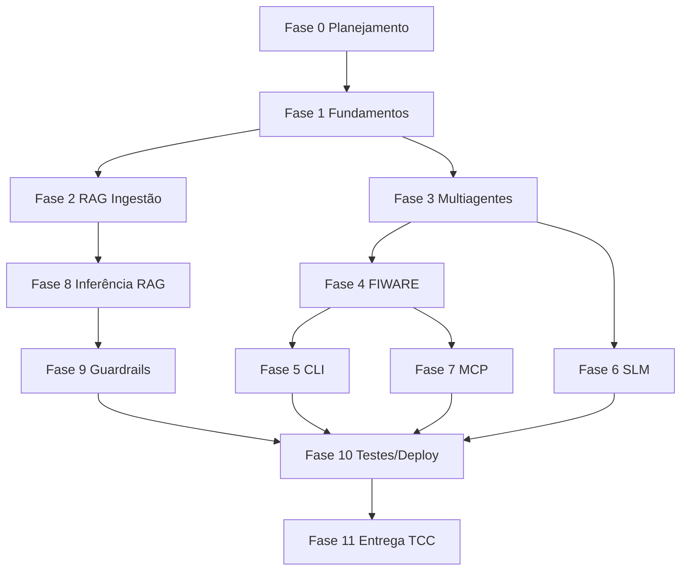

# Fases de desenvolvimento — TCC DKRT

Plano de evolução do **sistema multiagentes para FIWARE Context Broker com CLI e SLM**, alinhado ao [README principal](../../README.md) e aos diagramas em `docs/`.

## Visão do produto

| Dimensão | Descrição |
|----------|-----------|
| **Problema** | Operar o Orion Context Broker (NGSI-v2) exige conhecimento de API, payloads e contexto IoT — barreira para usuários e para automação com IA. |
| **Solução** | Orquestrador multiagentes + CLI + SLM + MCP, com base de conhecimento (RAG) e guardrails para geração segura de código e consultas. |
| **Stack** | Python 3.11+, asyncio, Typer, FIWARE/NGSI-v2, Transformers (phi-2), MCP HTTP. |

## Mapa de fases

| Fase | Arquivo | Foco | Status sugerido |
|------|---------|------|-----------------|
| 0 | [fase-00-planejamento-e-escopo.md](fase-00-planejamento-e-escopo.md) | Escopo, requisitos, pré-projeto | Concluída |
| 1 | [fase-01-fundamentos-e-ambiente.md](fase-01-fundamentos-e-ambiente.md) | Repo, Python, estrutura inicial | Em andamento |
| 2 | [fase-02-base-de-conhecimento-rag.md](fase-02-base-de-conhecimento-rag.md) | Ingestão, chunking, Small2Big | Em andamento |
| 3 | [fase-03-arquitetura-multiagentes.md](fase-03-arquitetura-multiagentes.md) | Orquestrador e agentes | Em andamento |
| 4 | [fase-04-integracao-fiware-ngsi.md](fase-04-integracao-fiware-ngsi.md) | Orion, cliente NGSI-v2 | Planejada |
| 5 | [fase-05-interface-cli.md](fase-05-interface-cli.md) | Typer, Rich, comandos | Planejada |
| 6 | [fase-06-slm-linguagem-natural.md](fase-06-slm-linguagem-natural.md) | phi-2, interpretação NL | Planejada |
| 7 | [fase-07-protocolo-mcp.md](fase-07-protocolo-mcp.md) | Ferramentas MCP | Planejada |
| 8 | [fase-08-inferencia-rag-tempo-real.md](fase-08-inferencia-rag-tempo-real.md) | Rewrite, HyDE, rerank | Planejada |
| 9 | [fase-09-guardrails-e-seguranca.md](fase-09-guardrails-e-seguranca.md) | PII, JSON Schema | Em andamento |
| 10 | [fase-10-testes-integracao-deploy.md](fase-10-testes-integracao-deploy.md) | pytest, Orion Docker, empacotamento | Planejada |
| 11 | [fase-11-entrega-e-avaliacao-tcc.md](fase-11-entrega-e-avaliacao-tcc.md) | Monografia, demo, métricas | Planejada |

## Dependências entre fases

## Como usar esta pasta

1. Antes de iniciar uma sprint, leia o arquivo da fase correspondente.
2. Atualize o campo **Status** e o checklist no final de cada fase.
3. Vincule commits e PRs à fase (ex.: `[Fase 4] cliente NGSI query_entities`).

## Artefatos relacionados

| Recurso | Caminho |
|---------|---------|
| Pré-projeto | `docs/entrega/pre_projeto_tcc.md` |
| Diagramas | `docs/*.png`, `docs/*.svg` |
| Prompts RAG | `prompts/` |
| Skills Cursor | `.cursor/skills/` |
| Código atual | `src/context_broker_agent/` |
