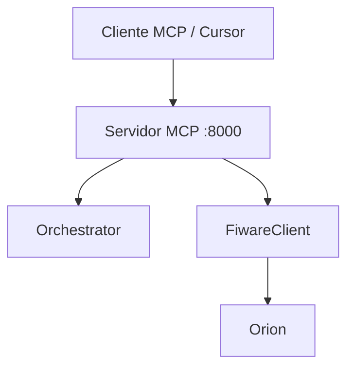

# Fase 7 — Protocolo MCP (Model Context Protocol)

| Campo | Valor |
|-------|-------|
| **Objetivo** | Expor ferramentas do DKRT para clientes MCP (ex.: Cursor, IDEs) via servidor HTTP JSON-RPC. |
| **Duração estimada** | 2–3 semanas |
| **Status** | Planejada |
| **Dependências** | [Fase 3](fase-03-arquitetura-multiagentes.md), [Fase 4](fase-04-integracao-fiware-ngsi.md) |

---

## 1. Contexto

Requisito **R4** inclui **MCP**. O protocolo permite que assistentes externos chamem **ferramentas** padronizadas (orquestrar, consultar Orion, interpretar NL) sem reimplementar a CLI.

## 2. Escopo v1

| Método / rota | Função |
|---------------|--------|
| `POST /mcp` | JSON-RPC 2.0 |
| `tools/list` | Lista ferramentas DKRT |
| `tools/call` | Executa ferramenta |
| `GET /health` | Health check |

### Ferramentas planejadas

| Nome | Descrição |
|------|-----------|
| `dkrt_orchestrate` | Executa orquestrador |
| `dkrt_query_entities` | Consulta NGSI via FiwareClient |
| `dkrt_interpret_nl` | SLM / heurística |

## 3. Integração com CLI

```bash
dkrt serve --host 0.0.0.0 --port 8000
```

Variável: `MCP_SERVER_PORT`.

## 4. Entregáveis

- [ ] `services/mcp_server.py` com aiohttp.
- [ ] Documentação de payload `tools/call` em `docs/`.
- [ ] Exemplo de chamada curl ou cliente MCP na monografia.
- [ ] Testes de integração do endpoint `/health` e `tools/list`.

## 5. Atividades

| # | Atividade |
|---|-----------|
| 7.1 | Implementar handler JSON-RPC |
| 7.2 | Registrar ferramentas com schemas de entrada |
| 7.3 | Reutilizar Orchestrator e FiwareClient (sem duplicar lógica) |
| 7.4 | Configurar CORS se necessário para clientes web |
| 7.5 | Segurança básica (bind localhost em dev; API key opcional) |

## 6. Critérios de conclusão

- [ ] Cliente MCP ou curl lista e invoca ≥ 3 ferramentas.
- [ ] Resposta em formato MCP (`content` com texto JSON).
- [ ] Servidor estável por ≥ 30 min em demo local.

## 7. Diagrama (posição no sistema)



## 8. Riscos

| Risco | Mitigação |
|-------|-----------|
| Spec MCP em evolução | Documentar versão testada |
| Expor Orion sem auth | Apenas localhost em desenvolvimento |

## 9. Próxima fase

→ [Fase 10 — Testes e deploy](fase-10-testes-integracao-deploy.md)

## 10. Referências

- [Model Context Protocol](https://modelcontextprotocol.io/)
- README §2.1 (protocolos)
