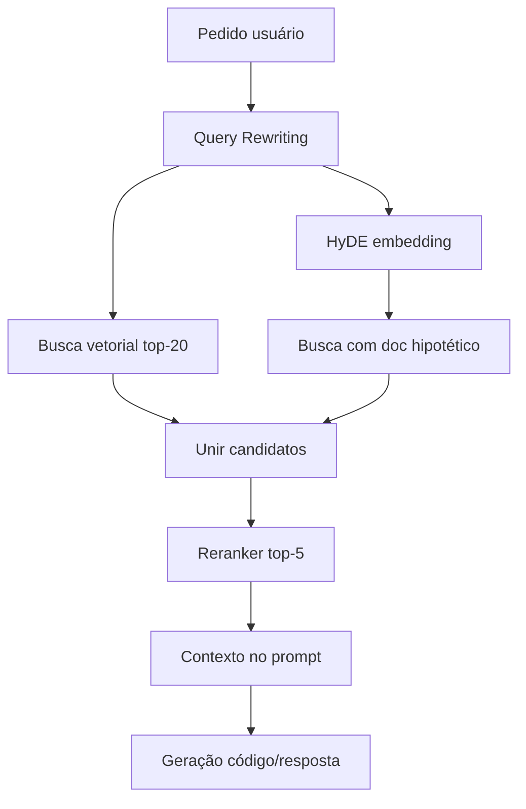

# Fase 8 — Inferência RAG em tempo real

| Campo | Valor |
|-------|-------|
| **Objetivo** | Na hora do pedido do usuário, recuperar o melhor contexto documental via query rewriting, HyDE e reranking antes de gerar código ou respostas. |
| **Duração estimada** | 2–3 semanas |
| **Status** | Planejada |
| **Dependências** | [Fase 2](fase-02-base-de-conhecimento-rag.md), [Fase 6](fase-06-slm-linguagem-natural.md) (opcional) |

---

## 1. Contexto

A **Fase 2** prepara o índice; esta fase define o **“pensamento” em tempo real** ao desenvolver ou responder:

1. **Query rewriting** — reformular pedido vago em termos NGSI/Python.
2. **HyDE** — documento hipotético para melhorar busca semântica.
3. **Reranking** — de ~20 candidatos para os 5 melhores chunks `big`.

## 2. Pipeline

## 3. Escopo

| Incluído | Excluído (v1) |
|----------|----------------|
| Prompts e skill `dkrt-rag-inference` | Serviço de embeddings em produção 24/7 |
| Protótipo de busca (local / script) | Reranker comercial obrigatório |
| Integração com skill `dkrt-tcc-codegen` | Multi-tenant |

## 4. Artefatos no repositório

| Artefato | Caminho |
|----------|---------|
| Query rewriting | `prompts/inference/query-rewriting.md` |
| HyDE | `prompts/inference/hyde.md` |
| Reranking | `prompts/inference/reranking.md` |
| Skill | `.cursor/skills/dkrt-rag-inference/` |

## 5. Entregáveis

- [ ] Script ou módulo `rag_retrieve.py` (busca + rerank simplificado).
- [ ] JSON de exemplo com `rewritten_queries` e `selected` chunks.
- [ ] Integração documentada no fluxo `prompts/code_generation.md`.
- [ ] Métrica: precisão @5 em conjunto de 20 perguntas de teste (manual).

## 6. Atividades

| # | Atividade |
|---|-----------|
| 8.1 | Implementar rewrite (regras + opcional LLM) |
| 8.2 | Prototipar HyDE para perguntas abertas |
| 8.3 | Rerank por cross-encoder ou LLM com lista de IDs |
| 8.4 | Filtrar por `metadata.category` conforme intenção |
| 8.5 | Medir tokens enviados ao gerador (budget) |

## 7. Critérios de conclusão

- [ ] Para 5 perguntas FIWARE, top-5 chunks contêm exemplo HTTP correto.
- [ ] HyDE não vaza texto hipotético como “documentação oficial” na resposta final.
- [ ] Pipeline documentado na monografia (subseção Metodologia).

## 8. Relação com SLM (Fase 6)

| Camada | Função |
|--------|--------|
| SLM | NL → intent + parâmetros NGSI |
| RAG inferência | NL → documentação de apoio para **implementação** correta |

Ambos podem alimentar o orquestrador na mesma requisição `ask`.

## 9. Próxima fase

→ [Fase 9 — Guardrails](fase-09-guardrails-e-seguranca.md)

## 10. Referências

- `prompts/inference/`
- Skill `dkrt-rag-inference`
