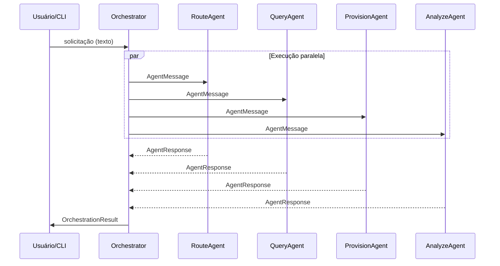

# Fase 3 — Arquitetura multiagentes

| Campo | Valor |
|-------|-------|
| **Objetivo** | Definir e implementar orquestrador, contrato de agentes, mensagens e execução paralela assíncrona. |
| **Duração estimada** | 3–4 semanas |
| **Status** | Em andamento |
| **Dependências** | [Fase 1](fase-01-fundamentos-e-ambiente.md) |

---

## 1. Contexto

O coração do DKRT é a **coordenação de agentes especializados**, conforme diagramas em `docs/Multiagent_Orchestrator-*.png` e `docs/diagrama_sequencia-*.png`.

Cada agente trata um tipo de intenção; o orquestrador dispara em paralelo e **agrega** resultados.

## 2. Visão arquitetural

## 3. Agentes planejados

| Agente | Responsabilidade | Depende de FIWARE |
|--------|------------------|-------------------|
| **RouteAgent** | Classificar intenção e papéis | Não |
| **QueryAgent** | Consultas NGSI-v2 | Sim (Fase 4) |
| **SubscribeAgent** | Planejar subscrições | Sim (Fase 4) |
| **ProvisionAgent** | Criar/atualizar entidades | Sim (Fase 4) |
| **AnalyzeAgent** | Resumir dados retornados | Opcional |

## 4. Contratos (modelos)

| Modelo | Função |
|--------|--------|
| `AgentMessage` | Entrada: `content`, `metadata`, `correlation_id` |
| `AgentResponse` | Saída: `agent_name`, `success`, `message`, `data`, `elapsed_ms` |
| `OrchestrationResult` | Agregado: `status`, `responses`, `aggregated_data` |

Implementação alvo: **Pydantic v2** + `BaseAgent` abstrato com `process()` e `execute_with_timeout()`.

## 5. Estado atual

| Item | Situação |
|------|----------|
| `MultiAgentOrchestrator` em `agents.py` | Implementado (versão simples) |
| Agentes QueryIntent + BrokerPlanning | Implementados |
| Execução paralela async | Evoluir para `asyncio.gather` |
| Agentes especializados completos | Planejado (refatorar `agents/`) |
| Logging structlog | Planejado |

## 6. Entregáveis

- [ ] Módulo `orchestrator.py` com `orchestrate(query)` assíncrono.
- [ ] Pacote `agents/` com `base.py` e um arquivo por agente.
- [ ] Testes: orquestração OK, timeout, agregação de papéis.
- [ ] Atualização do diagrama de sequência se o fluxo mudar.

## 7. Atividades

| # | Atividade |
|---|-----------|
| 3.1 | Extrair `BaseAgent` e mensagens Pydantic |
| 3.2 | Migrar orquestrador para async + gather |
| 3.3 | Implementar Route, Query, Subscribe, Provision, Analyze |
| 3.4 | Propagar `metadata` (ex.: entidades) para AnalyzeAgent |
| 3.5 | Testes unitários com mocks |

## 8. Critérios de conclusão

- [ ] ≥ 5 agentes registrados no orquestrador.
- [ ] Timeout configurável por agente.
- [ ] `OrchestrationResult` com status `ok` | `partial` | `error`.
- [ ] Documentação alinhada aos diagramas do README.

## 9. Riscos

| Risco | Mitigação |
|-------|-----------|
| Agentes duplicam lógica FIWARE | Centralizar HTTP em `FiwareClient` (Fase 4) |
| Deadlock / bloqueio | Não usar I/O síncrono dentro de `process()` |

## 10. Próximas fases

→ [Fase 4 — FIWARE](fase-04-integracao-fiware-ngsi.md)  
→ [Fase 6 — SLM](fase-06-slm-linguagem-natural.md) (pode usar RouteAgent)

## 11. Referências

- Diagramas: `docs/Multiagent_Orchestrator-2026-04-05-131317.png`
- README §2.1 (requisito R1)
